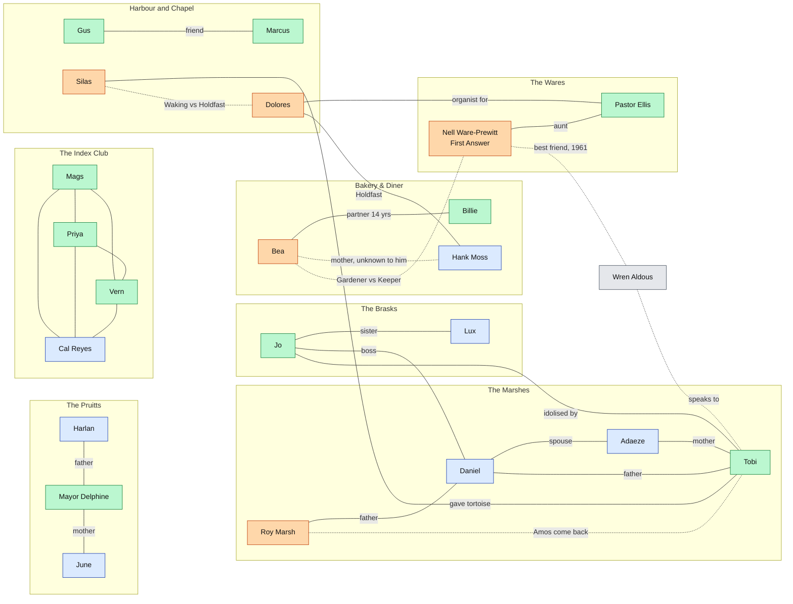

# UNDERSTUDY — The Relationship Web

> Four views of the same web: **who loves/is kin to whom**, **who is made of whom**, **who knows what**, and **how a performance ripples**. Spoilers throughout.
> Legend for diagrams: blue = human · orange = walk-on · green = playable Life (human at the time of the Take) · grey = the Held · dotted = secret.

---

## 1. Kin, love and loyalty

---

## 2. Who is made of whom

| Walk-on / Remnant | Life worn | Source / Resonance | Link to the living |
|---|---|---|---|
| Nell | Eleanor Ware, 9 | herself | Ellis is her nephew; Walt (husband, d. 2009) |
| Silas | Silas Weatherby, 22 | Thaddeus Rook, 61 | Rook's ghost lettering on the sign; Tobi's tortoise |
| Bea | Beatrix Lindgren, 23 | Hester Voss, 27 | Hank Moss is Hester's son |
| Dolores | Dolores Vance, 24 | Millie Vance, 52 | Organ on the Rise = Chapel organ of Low Mercy |
| Roy | Roy Marsh, 36 | Everett Marsh, 38 | His grandson Tobi carries Amos, Everett's son |
| Fitz | Fitzgerald Merriman, 20 | Ambrose Quill, 40 | The Low Water mirrors Quill's tavern |
| Connie | Constance Abara, 39 | Ida Prell, 44 | Post office on the Rise stands where Low Mercy's was mirrored |
| **13 Lives** | → | **Resonances** | |
| Mags | Dr. Margaret Pell | Casimir Pell, 63 | Granddaughter |
| Jo | Jonah Brask | Gideon Brask, 19 | Great-uncle |
| Tobi | Tobias Okafor-Marsh | Amos Marsh, 9 | Cousin once removed (Roy's cousin) |
| Delphine | Delphine Pruitt | Hattie Pruitt, 31 | Great-aunt |
| Vern | Vernon Castellano | Lowell Page, 40 | WMRC's founding voice |
| Gus | Augustin Tamm | Anders Tamm, 54 | Grandfather |
| Priya | Priya Nandakumar | Dorothea Hale, 14 | Mother's sister |
| Marcus | Marcus Dellacroix | Augustin Dellacroix, 52 | Great-grandfather |
| Billie | Wilhelmina Achterberg | Posy Achterberg, 34 | Great-aunt; recipe cards |
| Inez | Inez Calloway | Lucille Ashby, 26 | Teacher of Wren and Amos |
| Dottie | Dorothy Fenn | Pearl Aldous, 36 | Great-niece; **Wren's mother** |
| Oren | Oren Haldane | Walter Haldane, 48 | Great-nephew |
| Ellis | Ellis Ware | Ruth Ware, 34 | Grandmother; Nell's mother |

---

## 3. Who knows what (Day 1)

● knows · ◐ suspects · ○ doesn't · F1 walk-ons exist · F2 Nell is the Stage Manager · F3 Nell is Understudy #0 · F4 the census was falsified · F5 the Cut Clause · F6 the Taken are alive in the Still · F7 the Swing/Chorus exists · F8 Hymn #212 wakes walk-ons

| | F1 | F2 | F3 | F4 | F5 | F6 | F7 | F8 |
|---|---|---|---|---|---|---|---|---|
| **Nell** | ● | ● | ● | ● | ● | ● | ◐ | ● |
| **Bea** | ● | ◐ | ◐ | ○ | ○ | ● | ◐ | ● |
| **Silas** | ● | ◐ | ◐ | ◐ | ○ | ◐ | ◐ | ● |
| **Dolores** | ● | ● | ○ | ○ | ○ | ◐ | ○ | ● |
| **Roy** | ● | ○ | ○ | ○ | ○ | ◐ | ○ | ◐ |
| **Fitz** | ● | ○ | ○ | ○ | ○ | ○ | ○ | ◐ |
| **Connie** | ● | ○ | ○ | ○ | ○ | ● | ○ | ○ |
| **Mags** | ● | ○ | ○ | ○ | ○ | ○ | ○ | ○ |
| **Priya** | ◐ | ○ | ○ | ○ | ○ | ◐ | ○ | ○ |
| **Vern** | ◐ | ○ | ○ | ◐ | ○ | ○ | ○ | ● |
| **Cal** | ◐ | ○ | ○ | ○ | ○ | ◐ | ◐ | ○ |
| **Delphine** | ○ | ○ | ○ | ● | ○ | ○ | ○ | ○ |
| **Harlan** | ○ | ○ | ◐ | ● | ○ | ○ | ○ | ○ |
| **Ellis** | ○ | ○ | ◐ | ○ | ● | ○ | ○ | ○ |
| **Ottoline** | ○ | ○ | ● | ○ | ○ | ○ | ○ | ○ |
| **Oren** | ○ | ○ | ○ | ○ | ○ | ○ | ○ | ○ |
| **Marcus** | ◐ | ○ | ○ | ○ | ○ | ○ | ○ | ○ |
| **Adaeze** | ○ | ○ | ○ | ○ | ○ | ○ | ○ | ○ |
| **Dottie** | ◐ | ○ | ○ | ○ | ○ | ○ | ○ | ○ |
| **Hank** | ○ | ○ | ○ | ○ | ○ | ○ | ○ | ○ |
| **June** | ○ | ○ | ○ | ○ | ○ | ○ | ○ | ◐ |
| **Tobi / Wren** | ○ / ● | ○ / ● | ○ / ● | ○ / ● | ○ / ◐ | ○ / ◐ | ○ / ● | ○ / ● |

*Note:* Oren knows only the number. Marcus knows only the bodies. Adaeze knows only the certificates. That's the Hush: everyone holds one corner, and no two corners touch.

---

## 4. The edge table (public face / private truth / what moves it)

| A → B | Public | Private | What moves it |
|---|---|---|---|
| Nell → the Swing | A kindly old woman who knows everyone's name | She dresses your house each night | CANDOR makes her honest sooner; FIDELITY makes her warier |
| Nell → Wren | Never mentioned | Best friend; sleepover; guilt | Day 14, Day 15 |
| Nell → Ellis | Doting aunt | Lies to him about the safe | Ellis's Decision (Day 13) |
| Bea → Billie | Sweetheart couple | Fourteen years of keeping Billie from deciding | Day 9 |
| Bea → Hank | "Auntie Bea" who feeds him | His mother | Priya's 1971 gap; Ending 2 |
| Bea → Nell | Friendly rivals at the bake sale | Gardener vs Keeper | NERVE-heavy Chorus |
| Silas → Nell | Courtly customer | He confronted her in 1989 and left her the key | CURIOSITY |
| Silas → Dolores | Cordial | Waking vs Holdfast | Vern's Hymn (Day 5) |
| Dolores → Hank | "My boy" | She uses him | Hank's finding the stencil |
| Hank → June | Hates her stencils | Is slightly in awe | June's Day 12 stencil |
| Delphine → Harlan | Weekly visits, wary | He is the lie's last witness | Day 4 and the lucid minute |
| Delphine → June | Mother-daughter bickering | June has her vault key | Day 4 CANDOR |
| Mags → Cal | Dentist and deputy | Index Club; he forgets her | Day 1 recognition |
| Mags → Priya | Friends | Research partners | Thursday meeting |
| Priya → Vern | Colleagues | Decoding dedications | Day 5 |
| Vern → Dolores | Radio and organ | He's recorded her playing the Hymn | Day 5 |
| Jo → Lux | Band siblings | She told him to go; she wanted him to stay | Day 2 |
| Jo → Tobi | Idol and fan | Tobi's refusal is Jo's fault | Day 3 |
| Jo → Daniel | Boss and hand | Daniel keeps him from deciding | Day 2 |
| Tobi → Wren | Imaginary friend | She is real | Day 3, 14 |
| Tobi → Roy | Grandad | Roy sees Amos | Day 3, Act II |
| Tobi → Silas | Gave him the tortoise | Silas wants an ally | Day 3 |
| Adaeze → Marcus | Nurse/undertaker | The nine certificates | Day 8 |
| Gus → Marcus | Friends | Gus's Take triggers Marcus's | Day 6 → Day 8 |
| Marcus → Adaeze | Professional courtesy | Shared secret | Day 8 |
| Inez → Tobi | Teacher | She promised to protect his refusal | Day 10 |
| Inez → June | Former teacher | June is her best student | Day 10 |
| Dottie → Cal | Dog-sitting neighbours | She has the Dog Book; he has the notebook | Day 11 |
| Dottie → Wren | Unknown | Wren's dog is the Lake Dog | Day 11 |
| Oren → Delphine | Authority/town liaison | He has the Plug key | Day 12 |
| Oren → Nell | Never meet | She knows he does | Day 12 |
| Ellis → Dolores | Pastor/organist | She edits his hymn choices | Day 13 |
| Ellis → Nell | Pastor/aunt | He's afraid he'll hurt her | Day 13 |
| Fitz → Lux | Boss/employee | He's Quill; she's Lux | Act II |
| Connie → Cal | Postmaster and deputy | Postcards from his friends | Act III |
| Ottoline → Nell | Fight at the bake sale | She saw her come up dry | Act II |
| Roy → Daniel | Father/son | Roy came back "different" in 1989 | Act III |
| Harlan → Ottoline | Both at Lakeview Rest | They have never spoken of 1961 | Act II |
| June → Wren | Dreams | She hears the phrase | Day 12 |

---

## 5. Ripple rules

How a performance on Day N propagates. These are the lore constraints behind "IT STICKS"; the systems design in Deliverable 2 must honour them.

1. **The Remnant keeps your Notes.** What the Chorus did that day becomes that walk-on's personality, and persists.
2. **Relationships are copied, not reset.** The Remnant inherits the Taken's relationships *as the town remembers them* plus the player's modifications.
3. **People talk.** NPCs who saw you act in a role carry their impression into every later role. They don't know it's the same you; they know the Mags they saw.
4. **The Hush forgives, but only so far.** Out-of-character acts raise suspicion. Suspicion decays when the town is calm, and spikes in fog.
5. **Written things survive.** What you write down on the Case Board, your diaries, and your texts can be read by the Awakened and the humans with notebooks.
6. **Walk-ons learn from the Remnants.** If a Remnant is brave, nearby walk-ons notice.
7. **Overlap is real.** You can meet your own earlier Remnants in later roles. They greet you as the person you were.
8. **Animals remember.** Pets react to the Chorus the same way every time. The reaction is a tell.
9. **Faction pressure scales with NERVE.** Loud acts move the Holdfast and the Waking.
10. **Nell reads the Notes.** The Prompt Book mirrors the scoring.

### Worked chains

| Chain | Steps |
|---|---|
| **The Warm Dentist** | Mags WARM → Cal trusts the walk-on Mags → Cal shows her the notebook → the Priya Remnant's manuscript includes Cal's registry → the press replies → an outsider visits on the 11th → Oren's report lands on the same desk. |
| **The Loud Drummer** | Jo NERVE → plays the Reply at The Low Water → Fitz recognises the bell (Quill remembers) → Dolores hears → Holdfast sabotages Jo's gear on Day 11 → Lux finds the Tape. |
| **The Brave Child** | Tobi WARM+NERVE → refuses the lamp again → Roy tells Daniel "he's Amos" → Daniel signs the marina sale → he is not Taken (Ending 4 flag). |
| **The Honest Mayor** | Delphine CANDOR → shows June the vault → June's stencil hits the Town Hall → Hank repaints it in front of the mayor → Hank sees the wet paint match the vault key's colour. |
| **The Aired Hymn** | Vern NERVE → Hymn plays → Silas, Bea and Dolores Awaken in public → Dolores moves against Silas → Roy Awakens at his kitchen table → he calls Daniel. |
| **The Crossing** | Gus WARM → scatters Ingrid with Marcus → Marcus's service has a precedent → Billie cooks for the wake → Bea cries. |
| **The Truthful Teacher** | Inez CANDOR + NERVE → the real unit is taught → fourth-graders draw the lake truthfully → the Dog Book matches their drawings. |
| **The Pause** | Ellis CANDOR → the Wish is whole → Nell hears her name → she tries to stop the Raising → this is the central confrontation of Act III. |
